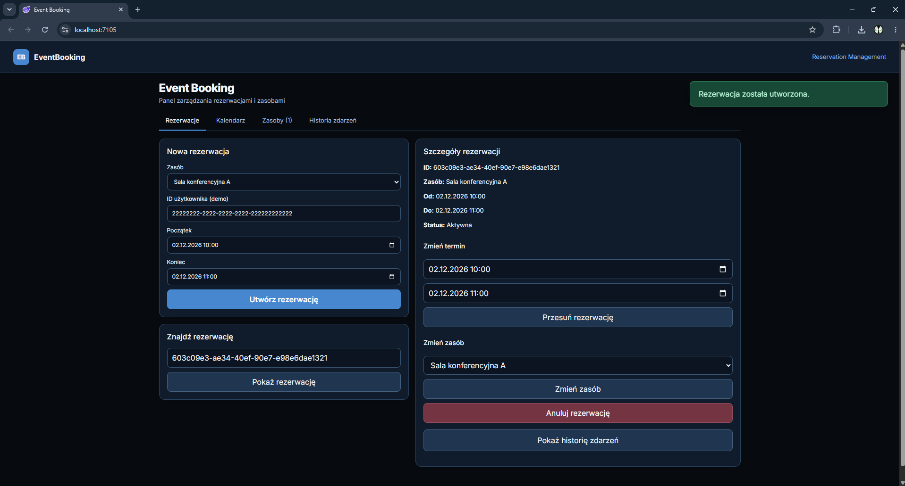
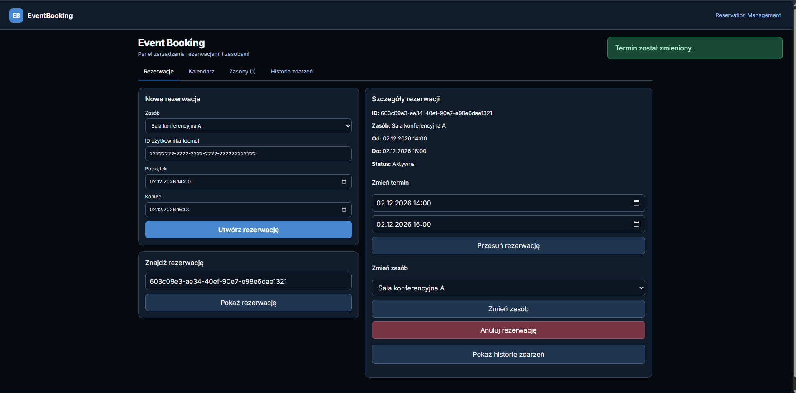
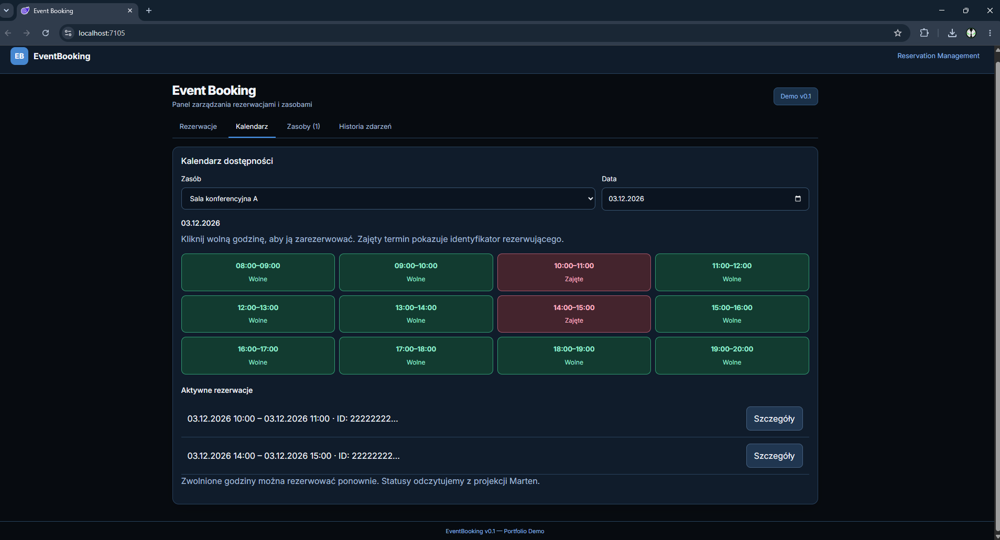
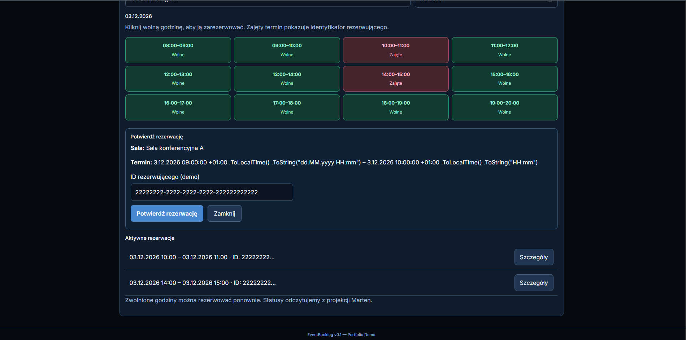
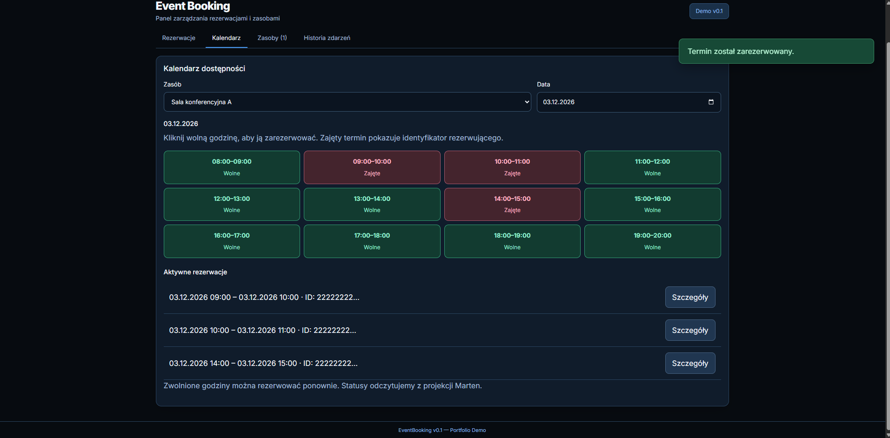
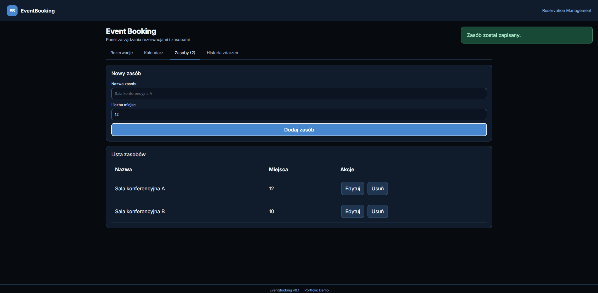
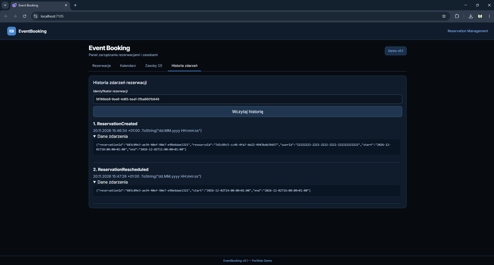
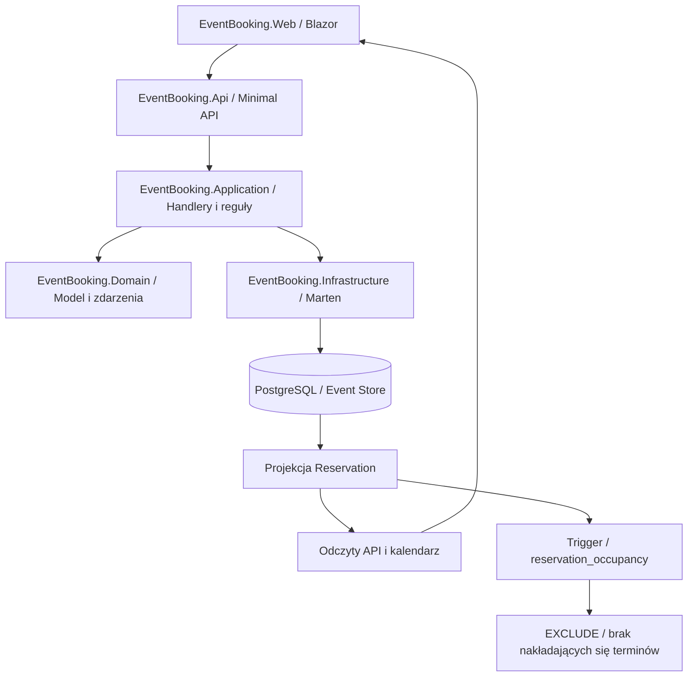
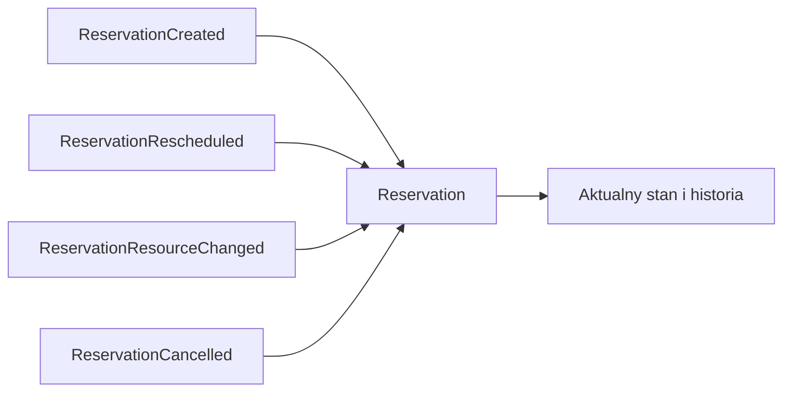

# EventBooking

**System rezerwacji zasobów oparty na .NET, Event Sourcing i CQRS.** Projekt portfolio prezentujący tworzenie rezerwacji, śledzenie zmian oraz zabezpieczenie przed podwójną rezerwacją tego samego zasobu — również przy jednoczesnych żądaniach.

> **Wersja:** 0.1 · **Status:** demo portfolio · **Testy:** 18 automatycznych testów (lokalnie) · **CI:** GitHub Actions (build i testy)

## Podgląd aplikacji

### Rezerwacje

Tworzenie i wyszukiwanie rezerwacji oraz dostęp do ich szczegółów.



### Zmiana terminu rezerwacji

Możliwość przesunięcia istniejącej rezerwacji bez utraty historii zmian.



### Kalendarz dostępności

Godzinowe kafelki kalendarza pokazują dostępność zasobów: **zielony — wolne**, **czerwony — zajęte**, **szary — minione**. Wolne terminy można rezerwować bezpośrednio z kalendarza.



### Rezerwacja przez kalendarz



### Potwierdzona rezerwacja przez kalendarz



### Zarządzanie zasobami

Tworzenie i zarządzanie zasobami, np. salami konferencyjnymi.



### Historia zdarzeń

Historia operacji na rezerwacji jest dostępna jako oddzielny widok.



## Najważniejsze możliwości

- Tworzenie, odczyt, anulowanie i przesuwanie rezerwacji.
- Zmiana zasobu przypisanego do rezerwacji.
- Tworzenie i zarządzanie zasobami.
- Kalendarz z godzinową dostępnością i interaktywną rezerwacją.
- Kontrola kolizji terminów i czytelne komunikaty w interfejsie.
- Historia zdarzeń oraz odtwarzanie aktualnego stanu rezerwacji.
- Zabezpieczenie współbieżności na poziomie PostgreSQL.
- Testy jednostkowe, integracyjne i API, uruchamiane również w GitHub Actions.

## Stos technologiczny

| Obszar | Technologia |
| --- | --- |
| Backend | C#, ASP.NET Core Minimal API, .NET 9 |
| Frontend | Blazor |
| Architektura | Modularny monolit, Event Sourcing, CQRS |
| Event Store i projekcje | Marten |
| Baza danych | PostgreSQL |
| Kontenery | Docker Compose, Testcontainers for .NET |
| Testy | xUnit |
| CI | GitHub Actions |

## Architektura

Rozwiązanie jest **modularnym monolitem** z oddzielonymi odpowiedzialnościami. Operacje zapisu tworzą zdarzenia biznesowe; Marten przechowuje je w PostgreSQL i aktualizuje projekcję wykorzystywaną przez odczyty oraz kalendarz.



### Zdarzenia rezerwacji



**Przykładowy proces:**

1. Klient wysyła żądanie utworzenia rezerwacji.
2. Handler weryfikuje dane oraz dotychczasowe konflikty terminów.
3. Marten zapisuje `ReservationCreated` i aktualizuje projekcję `Reservation`.
4. Trigger PostgreSQL synchronizuje tabelę `reservation_occupancy`.
5. Ograniczenie `EXCLUDE` nie pozwala zatwierdzić nakładających się zakresów dla tego samego zasobu.
6. API zwraca `201 Created` lub `409 Conflict`; interfejs pokazuje użytkownikowi czytelną informację.

**Dlaczego to istotne?** Samo sprawdzenie dostępności przed zapisem nie wystarcza, gdy dwa żądania wykonują się równocześnie. Ostateczna ochrona spójności znajduje się w bazie danych.

## Struktura rozwiązania

```text
EventBooking/
├── .github/workflows/ci.yml
├── Database/
│   └── 012_ReservationConcurrency.sql
├── EventBooking.Api/
├── EventBooking.Application/
├── EventBooking.Domain/
├── EventBooking.Infrastructure/
├── EventBooking.Tests/
├── EventBooking.Web/
├── screenshot/
├── docker-compose.yml
└── EventBooking.slnx
```

`EventBooking.Api` zawiera endpointy i konfigurację usług, `Application` — przypadki użycia, `Domain` — model i zdarzenia, `Infrastructure` — dostęp do danych i integrację z Marten, a `Web` — interfejs Blazor.

## Uruchomienie lokalne

### Wymagania

- .NET 9 SDK
- Docker Desktop z obsługą Docker Compose
- Aktualna przeglądarka internetowa

### Instrukcja

1. Sklonuj repozytorium i przejdź do jego katalogu.
2. Uruchom PostgreSQL:

   ```powershell
   docker compose up -d
   ```

3. Przy pierwszym uruchomieniu **nowej bazy** zastosuj skrypt zabezpieczający współbieżność **po utworzeniu tabeli projekcji `mt_doc_reservation` przez Marten**. Skrypt znajduje się w `Database/012_ReservationConcurrency.sql`; nie należy uruchamiać go jako skryptu SQL Server. Dla wcześniej przygotowanej bazy nie trzeba wykonywać go ponownie.
4. Uruchom API i aplikację Web (np. przez wielokrotne projekty startowe w Visual Studio), ewentualnie w osobnych terminalach:

   ```powershell
   dotnet run --project EventBooking.Api
   ```

   ```powershell
   dotnet run --project EventBooking.Web
   ```

5. Otwórz adres wypisany w konsoli projektu `EventBooking.Web`. W lokalnej konfiguracji deweloperskiej używano `https://localhost:7105`; API działało pod `https://localhost:7122`. Porty mogą różnić się zależnie od profilu uruchomieniowego.

> **Konfiguracja:** oba projekty wymagają prawidłowych ustawień połączenia. Lokalny PostgreSQL udostępniano na porcie `5433`. Nie zapisuj prawdziwych haseł ani sekretów w publicznym repozytorium. Wartości demonstracyjne mają służyć wyłącznie środowisku lokalnemu.

## Testowanie

Testy obejmują agregat i odtwarzanie zdarzeń, walidację komend, integrację Marten z PostgreSQL, endpointy HTTP, cykl życia rezerwacji oraz współbieżność.

```powershell
dotnet test EventBooking.Tests/EventBooking.Tests.csproj
```

**Zweryfikowany rezultat lokalny: 18 testów zakończonych powodzeniem.** Testy integracyjne uruchamiają izolowanego PostgreSQL przez Testcontainers — Docker musi być dostępny.

### Test współbieżności

Dwie równoczesne próby rezerwacji tego samego zasobu i przedziału są weryfikowane na poziomie HTTP oraz bazy:

| Kontrola | Oczekiwany wynik |
| --- | --- |
| Pierwsza zaakceptowana rezerwacja | `201 Created` |
| Druga, konfliktująca próba | `409 Conflict` |
| Liczba zapisanych zajętych przedziałów | `1` |

## Continuous Integration

Workflow `.github/workflows/ci.yml` uruchamia się na `push` i `pull_request`. Wykonuje przywracanie pakietów, kompilację rozwiązania i testy; wyniki testów zapisuje jako artefakt. Pipeline został zweryfikowany jako **Success** w GitHub Actions.

## Decyzje projektowe i ograniczenia

- **Modularny monolit zamiast mikroserwisów:** prostsze wdrożenie i diagnozowanie przy zakresie demo.
- **Event Sourcing:** historia zmian i odtwarzanie stanu są częścią celu edukacyjnego. W prostszych aplikacjach klasyczny CRUD mógłby być tańszy w utrzymaniu.
- **CQRS:** oddzielenie operacji biznesowych od modeli do odczytu.
- **PostgreSQL jako ostateczna ochrona spójności:** eliminuje ryzyko dwóch jednoczesnych zapisów tego samego terminu.
- **Testcontainers:** realna baza w testach zamiast imitacji zachowania PostgreSQL.

**EventBooking v0.1 jest projektem demonstracyjnym, a nie usługą gotową do produkcji.** Nie zawiera płatności, multi-tenancy, rozbudowanego RBAC, pełnej obsługi retencji danych ani gwarancji SLA. Pokazane dane i identyfikatory są demonstracyjne.

## Możliwe rozszerzenia

Uwierzytelnianie i role, rezerwacje cykliczne, powiadomienia, integracja kalendarzy zewnętrznych, raporty wykorzystania zasobów oraz monitoring. Nie są częścią zakresu wersji 0.1.

---

**EventBooking · Portfolio Demo v0.1**
